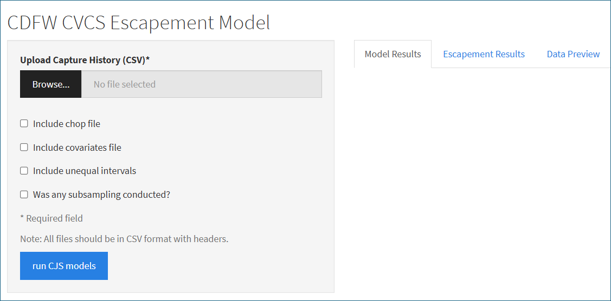
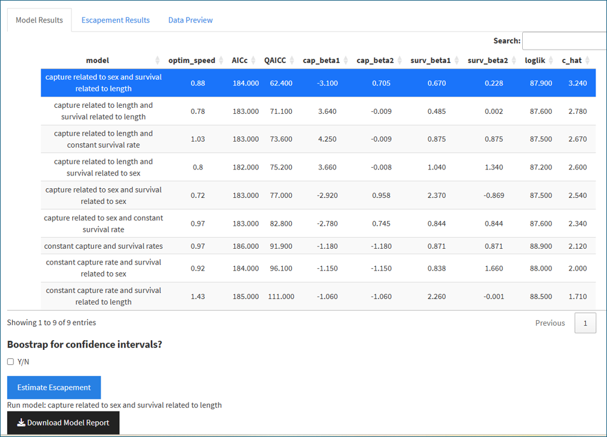
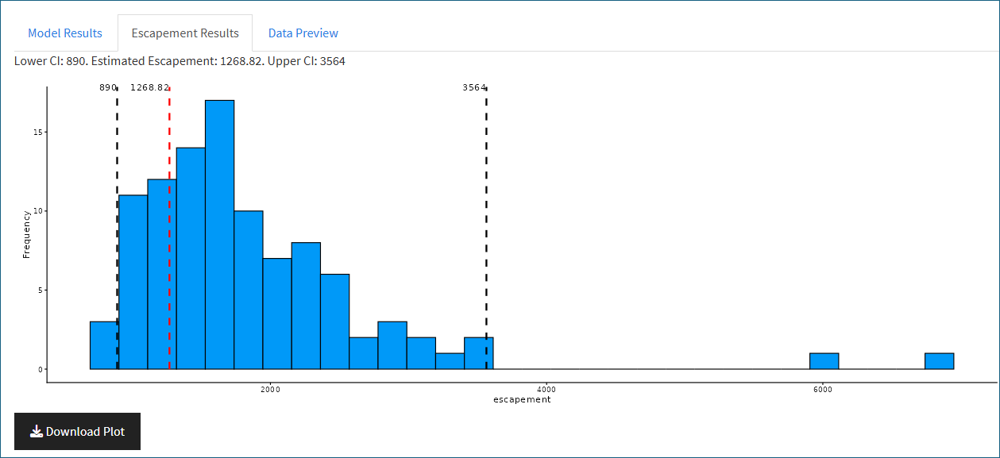
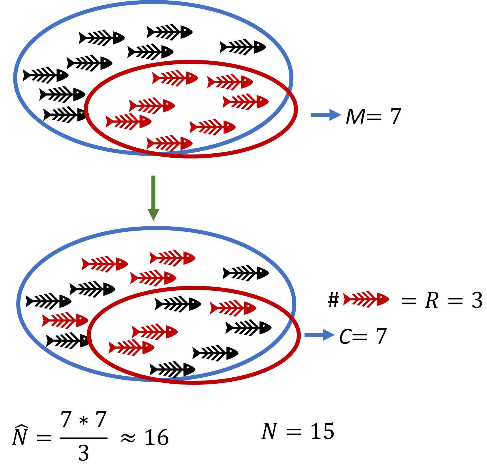

# Introduction

The following documentation reviews the methods, models, and code used to estimate the annual escapement of returning adult Central Valley Chinook Salmon (CVCS). This documentation begins with a user guide for utilizing the esc_est Shiny application, includes further details covering the Cormack-Jolly-Seber and super-population models, and details the functions built into the esc_est application.

The esc_est application is built in R using the Shiny package and currently hosted on the shinyapps.io page at <https://arthurbarros-cdfw.shinyapps.io/esc_est/>. This is a stand alone application that allows CVCS carcass survey teams to upload collected survey data and produce estimates of total escapement as well as uncertainty. The esc_est app is based on the model and methods used by the escapeMR application (<https://tmcd.shinyapps.io/escapemr/>) created by Trent McDonald for use by CDFW survey staff in 2020. The escapeMR application and related R package (<https://gitlab.com/tmcd/escapemr>) has been used by staff for several years to produce estimates of escapement; however, with the retiring of its author, the package and application has become a "black-box" model that is no longer updated or maintained. Currently the Department has no ways to make necessary changes to escapeMR, and documentation on how exactly it works is lacking. The esc_est application and related documentation aims to address this problem and provide a model that can be maintained and controlled by Department staff.

For general assistance with using and understanding the esc_est application and methods, or to report bugs or other issues, feel free to contact the author at [Arthur.Barros\@wildlife.ca.gov](mailto:Arthur.Barros@wildlife.ca.gov). The code that builds the esc_est application is updated on a GitHub repository at <https://github.com/arthurbarros-CDFW/esc_est>.

# User Guide for esc_est

{#fig-homescreen fig-alt="Image showing default page for esc_est." fig-align="center"}

Upon opening the esc_est application the user will see the home screen (@fig-homescreen) with data upload options on the the left side and result tabs (empty as default) on the right. The CJS model used in the application requires capture-history data to be uploaded before running, and also allows for a few other optional data sets to be utilized.

## *uploading data*

The esc_est application uses different data inputs to estimate the total escapement of CVCS to the relevant survey location. Carcasses are captured over $k$ occasions, usually weekly sampling events, marked with disctags, relevant covariates are recorded, and deposited back into the system for future recapture. All data must be uploaded as a .csv file with the proper formatting. Examples of file structure can be found in the GitHub repository at <https://github.com/arthurbarros-CDFW/esc_est/tree/main/data>. Uploaded data can be viewed in the "Data Preview" tab to ensure proper formatting and reading. Below is a list of data that can be uploaded to the application:

- **Capture histories** (required): the records of capture and recapture for a given carcass in this format

  $$\begin{bmatrix}
  DiscTag & S1 & S2 & S3 & S4 &... & k\\
  1601 & 1 & 0 & 1 & 1 &...\\
  1602 & 1 & 0 & 0 & 1 &...\\
  1603 & 0 & 0 & 1 & 1 &...\\
  1604 & 1 & 1 & 1 & 2 &...\\
  \end{bmatrix}$$

  Each record is for a tagged carcass and the subsequent sampling periods $j$. A value of 0 indicates the carcass was not captured, a value of 1 indicates the carcass was captured, and a value of 2 indicates the carcass was captured and "chopped" (beheaded) and removed from the system.

- **Chops** (optional): the record of the number of carcasses removed from the system upon first capture. This is done when the carcass is deteriorated beyond identification or measurement, and won't last long enough for further recaptures. The data can look like:

  $$\begin{bmatrix}
  S1 & S2 & S3 & S4 & S5 &... & k\\
  0 & 4 & 27 & 18 & 20
  \end{bmatrix}$$

  The chops data requires just one row recording the total chopped counts for each sampling period.

- **Covariates** (optional): records of relevant covariates for each captured and tagged carcass. Covariate data can be used to model the probability of capture ($p$) and survival ($\phi$) for each carcass. Currently the esc_est application is limited to length and sex data, but can be expanded upon in the future. The covariate data can look like:

  $$\begin{bmatrix}
  DiscTag & Sex & Length\\
  1601 & F & 200\\
  1602 & F & 223 \\
  1603 & M & 195\\
  1604 & M & 180\\
  \end{bmatrix}$$

  Each tagged carcass has length and sex recorded in the example data. A covariate table can be uploaded with only sex or length if both were not recorded. If covariate data is not included, the CJS model will assume homogenous capture and survival probabilities for all fish.

- **Intervals** (optional): Occasionally surveys may miss sampling periods for a variety of reasons. When this occurs it's important to incorporate these missed sampling periods into the model. In this instance the user should upload a small table that shows the intervals between survey periods:

  $$\begin{bmatrix}
  S1 & S2 & S3 & S4 & S5\\
  1 & 1 & 1 & 2 & 1
  \end{bmatrix}$$

  The above intervals tables shows a survey running over five sampling periods, in which there was a sampling gap between sampling periods three and four. Due to this missed sampling period, we can record an interval of "2" for period four, to represent the two intervals between it and the prior sampling period.

- **Subsampling** (optional): In some years, the escapement to survey grounds can be so high that it becomes unwieldy to handle or tag all carcasses encountered. This occurred during the 2025 sampling season on the American River when escapement was the highest seen in twenty years, prompting the survey teams to only handle one out of every other carcass. This necessitated the creation of methods to incorporate sub-sampling into the modelling. In order to process sub-sampling, the user should upload a dataset similar to that of the above intervals data:

  $$\begin{bmatrix}
  S1 & S2 & S3 & S4 & S5\\
  1 & 1 & 2 & 2 & 1
  \end{bmatrix}$$

  In the above data set, for weeks one, two, and five, carcasses were marked or checked for marks at the rate in which they were encountered. During weeks three and four every other carcass encountered was marked or checks for marks, so for those records the entry is "2".

## *Model comparison and selection*

Once the required and optional data is uploaded to the application, the user can click the "run CJS models" button at the bottom of the left panel. This begins the first step of model selection by fitting a null model as well as any models using covariates based on available data, and produces an output table showing model comparisons @fig-model_comparison .

{#fig-model_comparison}

The "Model Results" table shows:

- model - details how capture and survival were modeled.

- optim_speed - shows time (in seconds) for how long it took to optimize the loglikelihood of the model.

- AICc and QAICC - model "quality" tests (Akaike information criterion and Quasi-Akaike information criterions corrected for small sample sizes). The model results table is sorted so that the model with the best QAICC is at top and selected by default.

- cap_beta1 and cap_beta2 - coefficient values for the capture probability model.

- surv_beta1 and surv_beta2 - coefficient values for the survival probability model.

- loglik - the estimated log-likelihood of the model from the estimated coefficients.

- c_hat - overdispersion parameter for model testing.

The "Model Results" table defaults to select the model of best fit, but the user can click on a row to select a different model for escapement estimation. When a model is selected, the user can then check the "Bootstrap for confidence intervals?" and set the number of bootstrap iterations to use for estimating uncertainty. This option allows the user to calculate upper and lower 95% confidence intervals for the escapement estimate It is suggested that at least 100 bootstrap iterations are run to generate confidence intervals, and depending on the size of the data set this can take quite some time to process.

Finally the user can click on the "Estimate Escapement" button. This will begin estimating escapement using the selected model, and a progress bar will be displayed showing the current bootstrapping iteration when applicable.

## *Escapement Results*

{#fig-escapement_plot}

Once the model is finished running the user can click on the "Escapement Results" tab which will display a frequency plot of escapement estimates derived from model strapping, and the upper and lower 95% confidence intervals @fig-escapement_plot . If bootstrapping was not conducted no plot will be displayed, only a text output showing a point estimate for total escapement.

# An Overview of the CVCS Escapement Model

CVCS escapement estimation is made using a mark-recapture Cormack-Jolly-Seber (CJS) model. Mark and recapture is a common method for ecologists to estimate the size of a population of animals without needing to count each individual. Typically, an initial 'marking' period is conducted in which a sample of the population is captured and marked in some way so that those individuals can be recognized in the future. The marked individuals are then returned to the greater population and allowed time to mix back in. Later, another sampling period is conducted, during which a sample of the population is collected again, and the number of marked individuals in this sample is counted. This ratio can be used to estimate the size of the total population because the proportion of marked individuals in the second sample is assumed to be proportional to the number of total marked individuals in the population.

Regarding the CVCS escapement, mark-recapture surveys are conducted throughout the Central Valley in what is known as a "carcass survey." Periodically, field crews survey Chinook salmon spawning grounds, looking for adult carcasses. These carcasses are marked with disk tags and returned to the river. The crews usually return within a week to see if the carcasses are still in the system and mark new carcasses that have arrived.

## *The Lincoln-Petersen estimate*

The classic mark-recapture estimator is known as the **Lincoln-Petersen** estimate[@Petersen1896; @Lincoln1930] and utilizes the equation:

$$\hat{N}=\frac{MC}{R}$$

- $M$ is the number of individuals marked and released during the initial marking period.

- $C$ is the number of individuals (both marked and unmarked) captured in the recapture period.

- $R$ is the number of marked individuals recaptured in the later recapture period.

- $\hat{N}$ is the estimate of population abundance.

In the diagram below (@fig-lp_model), 7 fish from the population are captured and marked ($M$) during an initial capture and marking period. Then during a follow up recapture period, 7 fish are again captured ($C$), and of those 3 have markings ($R$). This provides us with an estimate of a total population ($\hat{N}$) of roughly 16 fish.

{#fig-lp_model fig-align="center" width="357"}

There are several important assumptions of the Lincoln-Petersen method:

1.  The population is closed so that $N$ is constant during the study period. No deaths, no births, no immigration or emigration.

2.  The probability of capture is equal across all individuals.

3.  Fish do not lose their markings between the two sampling periods.

4.  All marked fish recaptured during the second sampling period are accurately enumerated and recorded.

The Lincoln-Petersen method was expanded upon upon by Zoe Schnabel [-@Schnabel1938] with the **Schnabel estimator**, which allows for multiple periods of capture and recapture instead of just two.

$$\hat{N}=\frac{\sum_t(C_tM_t)}{\sum_tR_t}$$

This allows for marking to occur during multiple sampling periods $t$. One primary advantage of this method is multiple sampling periods allow for the detection of violation of the above assumptions. Regression of the proportion of marked animals to previously marked animals ($\frac{R_t}{C_t} \sim M_{t-1}$) will be straight if assumptions are met, and curved if the assumptions are violated.

If we examine our the annual carcass surveys performed across the Central Valley for returning Chinook salmon, we can easily identify ways in which the system violates the assumptions of the Lincoln-Petersen method:

- **Populations are open:** throughout the survey period adult Chinook arrive in the survey area, spawn, and die. At the same time spawned out carcasses that may or may not have been marked and counted are removed from the system either by scavengers, decay, or being flushed downstream.

- **Probability of capture is not homogeneous:** probability of"capture" for individual Chinook carcasses is really the probability it is spotted by survey field crews. This can be dependent on a number of factors including carcass size, carcass sex, water flow rates, and turbidity.

The above violations of the Lincoln-Petersen estimates could cause large biases in abundance estimates, and suggests that using this closed population model is ill advised.

## *The Cormack-Jolly-Seber model*

To deal with open populations and heterogeneous capture probabilities we can utilize a Cormack-Jolly-Seber (CJS) model [@Cormack1964; @Jolly1965; @Seber1965], which can deal with population changes during the survey period, as well as differences in capture probability among individuals. The CJS method does not directly provide estimates of abundance, instead it utilizes multiple sampling events during the survey period and allows us to calculate two important parameters:

- $\phi_{ij}$ : the probability carcass $i$ "survives" (remains in the system) from period $j$ to $j+1$.

- $p_{ij}$ : the probability carcass $i$ is captured during period $j$.

We will generate estimates for $p_{ij}$ and $\phi_{ij}$ using the CJS Maximum Likelihood Estimation methods later, but for now know that the probability of capture can be used to estimate the population size at period $j$ using the "**Horvitz-Thompson estimator**" [@Horvitz1952; @Nichols2005]:

$$\hat{N_j}=\sum_{i=1}^{n}\frac{h_{ij}}{\hat{p}_{ij}}$$ {#eq-horvitz_thompson}

Where $h_{ij}$ is either a 0 or 1 capture indicator for carcass $i$ at period $j$, and $n$ is the number of all carcasses observed over all survey periods. Basically the abundance of carcasses at time $j$ is equal to the sum of all the carcasses captured during that period divided by their capture probability.

Typically the total population estimate $\hat{N}$ can be calculated by taking the average value of $\hat{N}_j$, however there are problems with this method when many individuals are entering and leaving the population during the survey. This can be improved by using a *superpopulation* modification [@Ryan2013] to estimate total escapement as:

$$\hat{N}_{escapement}=\hat{N}_2\frac{ln(\tilde{\phi}_1)}{\tilde{\phi}_1-1}+B_2^*+B_3^*+...+B_{S-2}^*$$ {#eq-superpopulation_mod}

Where $S$ is the total number of all sampling occasions and $B_j^*$, the adjusted number of "births" (new adults entering the system and dying) between $j$ and $j+1$, is:

$$B_j^* = \tilde{B}_j\frac{ln(\tilde{\phi}_j)}{\tilde{\phi}_1-1}$$

$\tilde{B}_j$ is the total "births" for period $j$:

$$\tilde{B}_j=\hat{N}_{j+1} - \tilde{\phi}_{j}[\hat{N}_j-(n_j-R_j)]$$

and $R_j$ is the number of carcasses released with disctags during period $j$, $n_j$ is the number of carcasses captured during period $j$, and $\hat{N}_j$ is the estimate of abundance during period $j$ derived from the Horvitz-Thompson estimator in @eq-horvitz_thompson.

## *The CVCS Escapement Model*

While the @eq-superpopulation_mod used to estimate abundance using carcass survey data may seem relatively straight forward, it is heavily dependent on estimates of $p_{ij}$ and $\phi_{ij}$, which are much more complex to get.

We can represent the "capture history" of carcass $i$ each sampling period $j$ using the estimates of capture and survival probability as:

$$ \begin{matrix} j=1&\xrightarrow {\phi_{1i}}& j=2&\xrightarrow {\phi_{2i}}& j=3&\xrightarrow {\phi_{3i}}& j=4&\xrightarrow {\phi_{4i}}& j=5 &...\\   &&p_{2i} &&p_{3i} &&p_{4i} &&p_{5i} \end{matrix} $$

Let's say we have the following , simplified, set of capture histories for four carcass, across four different sampling periods:

$$\begin{bmatrix} DiscTag & S1 & S2 & S3 & S4 \\ 1601 & 1 & 0 & 1 & 1 \\ 1602 & 1 & 0 & 0 & 1 \\ 1603 & 0 & 0 & 1 & 1 \\ 1604 & 1 & 1 & 1 & 2 \\ \end{bmatrix}$$

If we look at the first row of data, the capture history for the carcass with disc-tag number 1601, we see it was captured and marked during period 1, not captured in period 2, and then captured again in periods 3 and 4. We can assign a probability of observing this capture history as:

$$P(1011|\text{release at period 1})=\phi_1(1-p_2)\phi_2p_3\phi_3p_4$$

In the above, $(1-p_2)$ is the probability that the carcass is not captured at period $j=2$. Now we can do the same with the rest of the example capture histories that we saw:

$$P_1(1011 |\text{release at period 1})=\phi_1(1-p_2)\phi_2p_3\phi_3p_4$$

$$P_2(1001|\text{release at period 1})=\phi_1(1-p_2)\phi_2(1-p_3)\phi_3p_4$$

$$P_3(0011|\text{release at period 3})=\phi_3p_4$$

$$P_4(1112|\text{release at period 1})=\phi_1p_2\phi_2p_3\phi_3p_4$$

In the above note the 2 at the end of the last capture history representing a chopped event. Also note that for $P_3$ the likelihood conditions on the initial observation at $j=3$ , and excludes estimates of $\phi$ or $p$ before that period.

We can use those equations to estimate the total likelihood of observing all the capture histories observed as:

$$L=P_1*P_2*P_3*P_4$$

Or as the product of all $n$ of the capture history probabilities [@Amstrup2005]:

$$L=\prod_{i=1}^n P_i$$

To make the computing of this probability easier we can log-transform our likelihoods so that:

$$ln(L)=\sum_{i=1}^n ln(P_i)$$ {#eq-log_likelihood}

This is known as the "log-likelihood" of the probability. Using this simple example above, we have a way to estimate the probability of observing a set of given capture histories if we have the capture ($p$) and survival ($\phi$) probabilities associated with each capture history.

Of course, we don't know these probabilities, and they will likely vary for each carcass and each period. Possible covariates could include size of carcass, carcass sex, or environmental variables such as temperature, flow, or turbidity. For CVCS work, we currently utilize covariates of sex and length to try and estimate capture and survival probabilities. For our example we will consider a CJS model in which capture probability is a function of length, and survival probability is a function of sex.

$$P(capture|length) = \hat{p}_{ij}$$

$$P(survival|sex) = \hat{\phi}_{ij}$$

These functions can best be represented with logistic regression models:

$$\hat{\phi}_{ij}=\frac{e^{\Upsilon_0+\Upsilon_1x_{ij}}}{1+e^{\Upsilon_0+\Upsilon_1x_{ij}}}$$

$$\hat{p}_{ij}=\frac{e^{\beta_0+\beta_1y_{ij}}}{1+e^{\beta_0+\beta_1y_{ij}}}$$

Where $x_{ij}$ is the sex of a given carcass, and $y_{ij}$ it's length. To ease in estimating the coefficients $\Upsilon$ and $\beta$ we can turn the above into linear models:

$$ln(\frac{\hat{\phi}_{ij}}{1-\hat{\phi}_{ij}})=\Upsilon_0+\Upsilon_1x_{ij}$$

$$ln(\frac{\hat{p}_{ij}}{1-\hat{p}_{ij}})=\beta_0+\beta_1y_{ij}$$

with $ln(\frac{\hat{\phi}_{ij}}{1-\hat{\phi}_{ij}})$ and $ln(\frac{\hat{p}_{ij}}{1-\hat{p}_{ij}})$ as our logit functions, used as "link functions" to model the probabilities as linear functions of covariates [@Amstrup2005].

You can see above that if we can estimate the coefficients of those two equations, for a given sex or length ($x_{ij},y_{ij}$) we can estimate the corresponding probability of survival or capture. To estimate the coefficients of $\Upsilon_0$, $\Upsilon_1$, $\beta_0$, and $\beta_1$, we can use a method know as **maximum log-likelihood estimation (MLE)** or optimization. To do this we first need to be able to estimate the log-likelihood of our model on a given set of coefficients and capture histories, basically: what is the log-likelihood of the capture histories we observed given a set of coefficients?

If we refer back to @eq-log_likelihood, the log-likelihood of all the observed capture histories is equal to the sum of the log-likelihood of each individual capture history $P_i$. The log--likelihood of the capture history for a given carcass $i$ can be given as the sum of its capture and survival probabilities from its first to last encounter, plus $\chi_i$: the probability it is not captured after its last release [@Mcdonald2001]. This individual capture history log-likelihood can be represented as:

$$ln(P_i)=\sum_{j=first}^{last}[h_{ij}*ln(\hat{p}_{ij})+(1-h_{ij})*ln(1-\hat{p}_{ij})+ln(\hat{\phi}_{j-1,i})]+\chi_i$$ {#eq-indivdual_loglik}

Where $h_{ij}$ is 1 if the carcass was observed during $j$, and 0 otherwise. $\chi_i$ can be represented as:

$$\chi_i=(1-\hat{\phi}_{last,i})+\prod_{j=last}^n \hat{\phi}_{ij}*(1-\hat{p}_{j+1,i})*(1-\hat{\phi}_{(n-1),i})$$

The first part of @eq-chi $(1-\hat{\phi}_{last,i})$ represents the probability the given carcass is removed from the system immediately after its last observation. The second part of @eq-chi is the product of all probabilities that carcass remained in the system but wasn't observed during all subsequent observation periods.

Now we have @eq-indivdual_loglik that provides us with the log-likelihood of observing a given capture history with specific survival and capture probabilities. We have also shown that values of $\phi_{ij}$ and $p_{ij}$ can be linearly regressed across the coefficients $\Upsilon_0$, $\Upsilon_1$, $\beta_0$, and $\beta_1$ (@eq-logit1 and @eq-logittwo). So now we can plug in values for the coefficients to give us capture and survival probabilities for a given carcass $i$ during period $j$, which we can put into @eq-indivdual_loglik to give us the log-likelihood of observing the capture history of that carcass using those coefficients. This process can be repeated for each carcass and summed to give us the total log-likelihood of all capture histories for all carcasses in @eq-log_likelihood . We can then repeat this whole process with new coefficient values until we find the coefficients of @eq-logit1 and @eq-logittwo that provide us with the **maximum log-likelihood**. For a good explanation of how maximum likelihood works, I highly recommend this YouTube video: <https://www.youtube.com/watch?app=desktop&v=XepXtl9YKwc>, which does a good job summarizing the basic concept.

Of course, repeating the above steps to find the highest log-likelihood for even just one carcass history would take a long time to do manually, and we need to find the coefficients that will provide the highest likelihood across all of our capture histories and covariates. Fortunately, we can use an optimization algorithm to automate this process, and find the coefficients that produce the maximum likelihood estimation for us. I won't expand on how MLE optimization algorithms work specifically, but we will be using optimization functions that are available in base R, which will be discussed later.

Once an optimization algorithm provides us with the coefficients that give us the maximum likelihood of observing our capture history data with the given covariates, we can use it to calculate the capture probability for each carcass ($\hat{p}_{ij}$) given it's length and sex. Those probabilities can then be utilized with the Horvitz-Thompson estimator (@eq-horvitz_thompson) to estimate total escapement for each period, and in turn providing an overall escapement estimate.

# esc_est Functions

This section provides brief

## *B_star*

Calculates $R_j$, the number of carcasses released with tags during period $j$, and $n_j$ the number of carcasses captured during $j$. Utilizes the `Horvitz_Thompson()` function to estimate $N_j$. Uses $B1$ and `s_hat` to calculate $B^{*}_j$, the number of "births" (new carcasses entering area) between $j$ and $j+1$.

**Parameters:**

- `ch`: matrix of capture probabilities.

- `s_hat`: matrix of survival probability estimates for each carcass $i$ at sampling period $j$.

- `p_hat`: matrix of capture probability estimates for each carcass $i$ at sampling period $j$.

- `subsampling_weeks`: matrix of weeks in which subsampling occurred.

- `observed_per_week`: matrix of number of carcasses observed each week. Derived from number tagged each week \* sub.sampling.

- `tagged_per_week`: matrix of number of carcasses tagged each week. Derived as `colSums(ch>=1,na.rm=T)`.

**Return:**

- `Bstar`: Estimate of number of "births" between $j$ and $j+1$.

## *CJS_bootstrap*

Bootstrapping function that randomly samples capture history and covariate records to estimate uncertainty, as upper and lower 95% confidence intervals, for the final escapement estimates.

**Parameters:**

- `iterations`: number of bootstrap iterations to perform, set by user in app.

- `ch`: matrix of capture probabilities.

- `cap_X`: matrix of capture related covariates.

- `surv_X`: matrix of survival related covariates.

- `ints`: confidence intervals, defaults to 95%.

- `subsampling_weeks`: matrix of weeks in which subsampling occurred.

- `observed_per_week`: matrix of number of carcasses observed each week. Derived from number tagged each week \* sub.sampling.

- `tagged_per_week`: matrix of number of carcasses tagged each week. Derived as `colSums(ch>=1,na.rm=T)`.

**Return:**

- `results`: data frame that contains the log-likelihood, escapement estimate, and processing time for each bootstrap iteration.

## *cjs_fit_simple*

Wrapper function that calls model fitting functions for model comparison. Allows user to select best fit model or model of choice for estimate total escapement.

**Parameters:**

- `ch`: matrix of capture probabilities.

- `beta`: list of the four model parameters optimized by `cpp_optim()`.

- `cap_X`: matrix of capture related covariates.

- `surv_X`: matrix of survival related covariates.

- `ints`: confidence intervals, defaults to 95%.

**Return:**

- `c_hat`: output used in model fitting for estimating QAIC for comparing model fits.

## *CJS_model_select_app*

Function that sets model parameters using `ch` and covariate matrices.

**Parameters:**

- `ch`: matrix of capture probabilities.

- `covars_used`: checks uploaded data to see if covariates included.

- `sex_matrix`: matrix of sex covariate data.

- `lengths_matrix`: matrix of length covariate data.

**Return:**

- list with capture histories and covariate matrices for each model possible for available covariates.

## *fill_prob_matrices*

Builds matrices of survival and capture probabilities. Called by `total_escapement()`.

**Parameters:**

- `ch`: matrix of capture probabilities.

- `beta`: list of the four model parameters optimized by `cpp_optim()`.

- `cap_X`: matrix of capture related covariates.

- `surv_X`: matrix of survival related covariates.

- `ints`: confidence intervals, defaults to 95%.

**Return:**

- `est_list`: list with matrices of estimate capture and survival probabilities for each carcass at each observation point.

## *Horvitz_Thompson*

Uses optimization outputs to estimate escapement for each survey period with @eq-horvitz_thompson.

**Parameters:**

- `ch`: matrix of capture probabilities.

- `p_hat`: matrix of capture probability estimates for each carcass $i$ at sampling period $j$.

- `subsampling_weeks`: matrix of weeks in which subsampling occurred.

- `observed_per_week`: matrix of number of carcasses observed each week. Derived from number tagged each week \* sub.sampling.

- `tagged_per_week`: matrix of number of carcasses tagged each week. Derived as `colSums(ch>=1,na.rm=T)`.

**Return:**

- `N_hat`: list with estimate of $N_j$ for each observation period. Called by `total_escapement()` and `B_star()`.

## *pro_capsur*

Produces estimate of capture and survival probabilities for a given carcass $i$ at time $j$. Called by `fill_prob_matrices()`.

**Parameters:**

- `i`: index for specific carcass record.

- `j`: index for specific observation/capture period.

- `ch`: matrix of capture probabilities.

- `beta`: list of the four model parameters optimized by `cpp_optim()`.

- `cap_X`: matrix of capture related covariates.

- `surv_X`: matrix of survival related covariates.

- `ints`: confidence intervals, defaults to 95%.

**Return:**

- `est_list`: list with matrices of estimate capture and survival probabilities for each carcass at each observation point.

## *total_escapement*

Produces estimate of total escapement for survey period.

**Parameters:**

- `ch`: matrix of capture probabilities.

- `beta`: list of the four model parameters optimized by `cpp_optim()`.

- `cap_X`: matrix of capture related covariates.

- `surv_X`: matrix of survival related covariates.

- `ints`: confidence intervals, defaults to 95%.

- `subsampling_weeks`: matrix of weeks in which subsampling occurred.

- `observed_per_week`: matrix of number of carcasses observed each week. Derived from number tagged each week \* sub.sampling.

- `tagged_per_week`: matrix of number of carcasses tagged each week. Derived as `colSums(ch>=1,na.rm=T)`.

**Return:**

- `ans`: list with `p_hat` and `s_hat` matrices, `N_hat` for each sampling period, `Bstar`, and estimate of total escapement for survey period.

## *cpp_optim*

Utilizes the base R `optim()` call within C++ "CJS_functions.cpp" script. Leverages higher speeds of C++ to decrease the optimization time.

**Parameters:**

- `par`: initial default beta parameters of `c(0,0,0,0)`.

- `fn`: function to optimize, `cpp_CJSwrapper()`.

- `method`: optimizes using the "BFGS" (Broyden–Fletcher–Goldfarb–Shanno) algorithm.

- `ch`: matrix of capture probabilities.

- `cap_X`: matrix of capture related covariates.

- `surv_X`: matrix of survival related covariates.

- `ints`: confidence intervals, defaults to 95%.

# Comparing esc_est to escapeMR

fill
